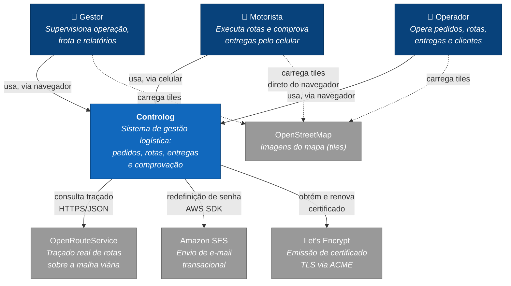
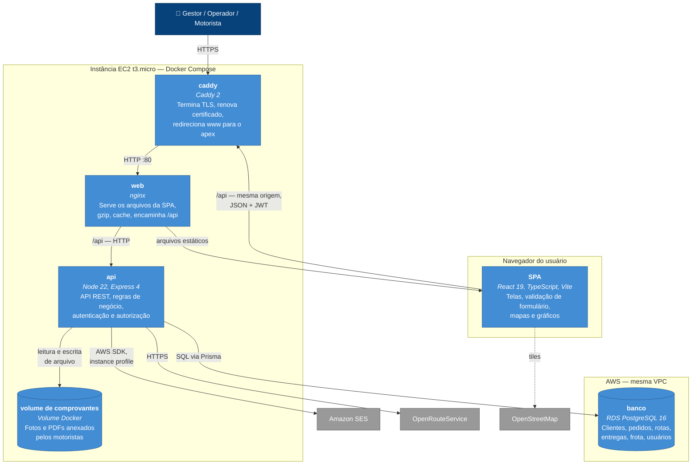
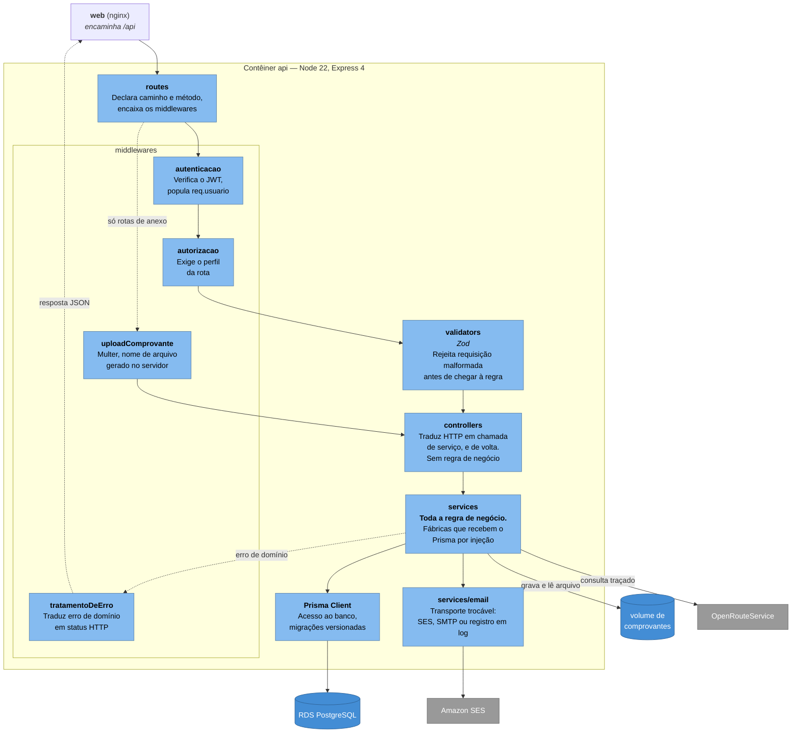
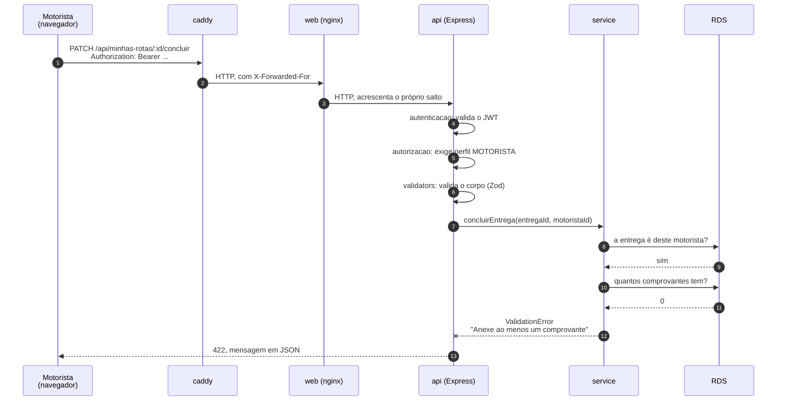
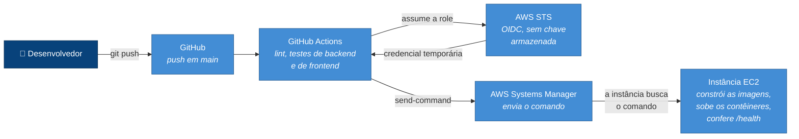

# Arquitetura — Controlog

Este documento descreve a arquitetura do sistema nos três primeiros níveis do
modelo **C4**: contexto, contêineres e componentes.

> **Sobre a notação.** Os diagramas usam Mermaid em sintaxe `flowchart`, com as
> fronteiras do C4 representadas por `subgraph`, e não a sintaxe experimental
> `C4Context`/`C4Container`. O motivo é prático: a sintaxe experimental ainda
> produz sobreposição de caixas em vários visualizadores, incluindo o próprio
> GitHub. A semântica do C4 — pessoa, sistema, contêiner, componente, fronteira
> — está preservada nos rótulos e na legenda de cada nível.

---

## Nível 1 — Contexto

Quem usa o sistema e com quais sistemas externos ele conversa.

**Legenda.** Azul-escuro é pessoa; azul é o sistema em questão; cinza é sistema
externo. Linha cheia é chamada do servidor; linha tracejada é chamada feita pelo
navegador do usuário, sem passar pelo backend.

**Por que os tiles vêm direto do navegador.** As imagens do mapa são buscadas
pelo Leaflet, no cliente, sem intermediação da API. Isso evita que a instância
sirva de proxy para tráfego de imagem — que seria o maior volume de dados do
sistema e consumiria banda e CPU de uma `t3.micro` sem nenhum ganho.

---

## Nível 2 — Contêineres

As unidades executáveis e de armazenamento dentro do Controlog. Todas, exceto o
banco, rodam como contêineres Docker na **mesma instância EC2**.

### Decisões visíveis neste nível

**A SPA e a API ficam atrás do mesmo domínio.** O frontend chama `/api` em
caminho relativo, não uma URL absoluta. Não existe requisição entre origens
diferentes, então não há CORS a configurar em produção, e o pacote compilado não
fica preso a um domínio escolhido no momento do build.

**Caddy e nginx coexistem de propósito.** O nginx já servia a SPA e já
encaminhava `/api`; o Caddy entrou **na frente** apenas para o TLS, porque obtém
e renova o certificado sozinho — sem `cron`, sem *hook* de renovação e sem
recarregar o nginx.

**Os comprovantes ficam em volume, não no banco e não na imagem.** A imagem é
recriada a cada deploy, então um arquivo gravado nela desapareceria. O banco
guarda apenas os metadados do comprovante — nome original, tipo, tamanho e
caminho.

> **Limitação conhecida.** Como os arquivos vivem num volume e os metadados no
> RDS, um *snapshot* do banco **não** cobre os comprovantes. Restaurar o banco
> sozinho devolveria entregas concluídas cujo comprovante não abre. A
> compensação é cópia do volume ou *snapshot* do EBS, junto do *snapshot* do
> banco.

---

## Nível 3 — Componentes da API

Como o contêiner `api` é organizado internamente.

### A regra que organiza tudo

**A regra de negócio vive no `services`, e em nenhum outro lugar.** Controller
não decide; validador não decide; tela não decide. A consequência prática é que
uma requisição direta à API não contorna nenhuma regra — e foi por isso que o
comprovante obrigatório foi implementado no serviço, não no botão desabilitado.

**Os serviços recebem o Prisma por injeção.** Cada um é uma fábrica
`criarXService(prisma)`. É isso que permite testar a regra com um dublê, sem
banco rodando, e é a razão de a suíte do backend terminar em segundos no CI.

**O `services/email` tem transporte trocável.** Em produção, Amazon SES por
*instance profile*; em desenvolvimento, registro em log. A escolha é por
variável de ambiente, e um valor inválido faz a aplicação falhar ao subir, em
vez de descobrir o problema no primeiro e-mail que não chegou.

---

## O caminho de uma requisição

Exemplo: o motorista marca uma entrega como concluída.

**Dois saltos de proxy, e por que isso importa.** O nginx recebe o
`X-Forwarded-For` do Caddy e acrescenta o próprio salto, então a API vê
`cliente, caddy`. O Express é configurado com `TRUST_PROXY=2`. Com o valor 1, o
IP lido seria o do contêiner do Caddy, e o limitador de requisições trataria
**todos os usuários como um cliente único** — sem nada no log indicando o
problema.

---

## Deploy

**Não há SSH e não há chave guardada.** O *security group* libera a porta 22
apenas para um IP fixo, e os *runners* do GitHub têm IP dinâmico. As saídas por
SSH seriam abrir a porta 22 para a internet ou versionar a chave privada da
instância — as duas piores do que o problema. Com o SSM, a instância é quem abre
a conexão para fora; nenhuma porta nova é exposta.

A confiança da role é amarrada a
`repo:davigpe/controlog:ref:refs/heads/main` com `StringEquals`, sem curinga:
nem outro ramo nem outro repositório conseguem assumi-la.

As migrações rodam **antes** de a API passar a escutar a porta. Migração que
falha significa contêiner que nunca fica saudável, o que significa deploy
reprovado — nada quebrado chega ao ar.

---

## Documentos relacionados

| Documento | O que cobre |
|---|---|
| [REQUISITOS.md](REQUISITOS.md) | Requisitos funcionais, não funcionais, regras de negócio e casos de uso |
| [DEPLOY_AWS.md](DEPLOY_AWS.md) | Provisionamento, variáveis de ambiente e contingência manual |
| [PLANO_DE_TESTES.md](PLANO_DE_TESTES.md) | Casos de teste por requisito e estratégia das duas camadas |
| [AUDITORIA_ACESSIBILIDADE.md](AUDITORIA_ACESSIBILIDADE.md) | Conformidade WCAG 2.1 AA |
